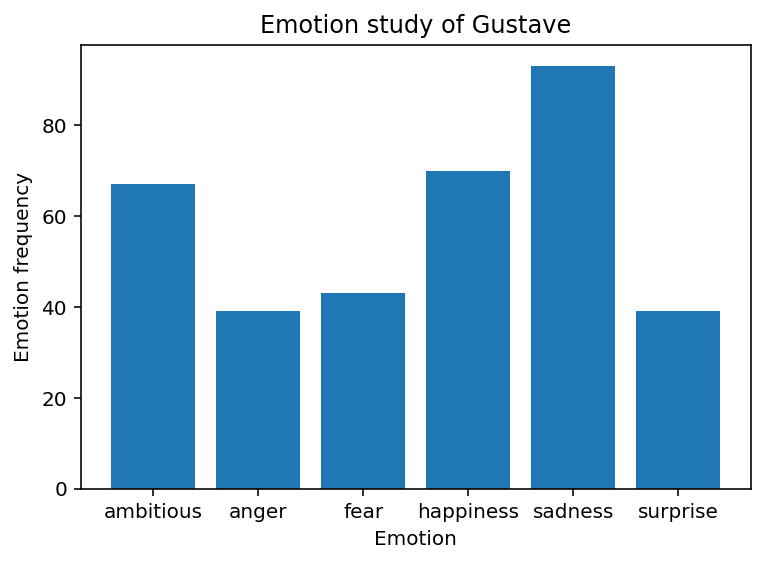
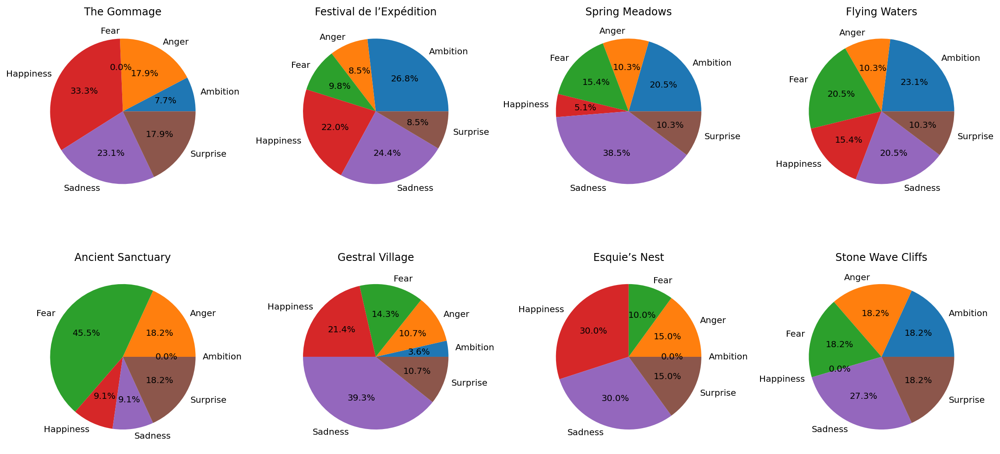

# PersonaForge

## A Digital Persona Reconstruction Framework

PersonaForge is an AI framework designed to reconstruct how an individual thinks, reasons, makes decisions, and evolves.

Unlike traditional chatbots that rely primarily on retrieval or similar conversation matching, PersonaForge attempts to model:

- Personality Traits
- Beliefs
- Values
- Goals
- Emotional Tendencies
- Decision-Making Patterns

The current prototype uses **Gustave** from *Clair Obscur: Expedition 33* as a controlled test subject to explore digital persona preservation.

---

# Project Vision

The long-term goal of PersonaForge is to preserve an individual's identity by modelling:

```text
Identity
  ├── Traits
  ├── Beliefs
  ├── Values
  ├── Goals
  └── Experiences
```

Instead of answering questions by finding similar responses, PersonaForge aims to answer:

> "What would this person decide?"

---

# Emotional Analysis

## Overall Emotion Distribution



The emotional analysis indicates that sadness is the dominant emotion in Gustave's dialogue, followed by happiness and ambition. This aligns with his role as a determined individual carrying emotional burdens while maintaining hope for a better future.

---

## Emotional Evolution Throughout the Story



The emotional timeline highlights how Gustave's emotional state changes across major story locations. Certain chapters show spikes in fear and sadness, while others demonstrate increases in ambition, happiness, and resilience
